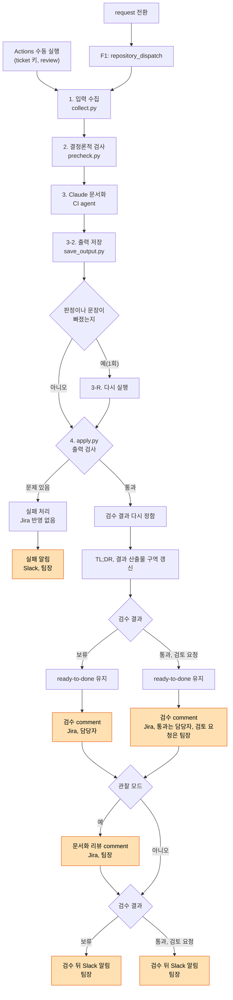
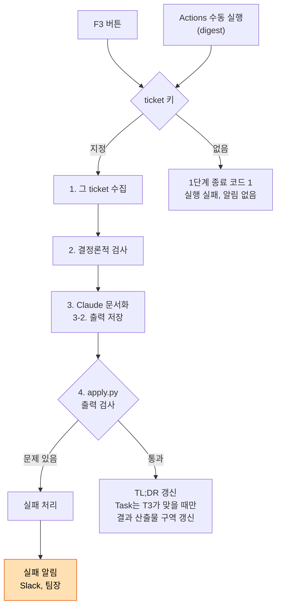
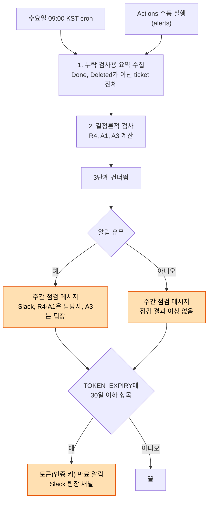
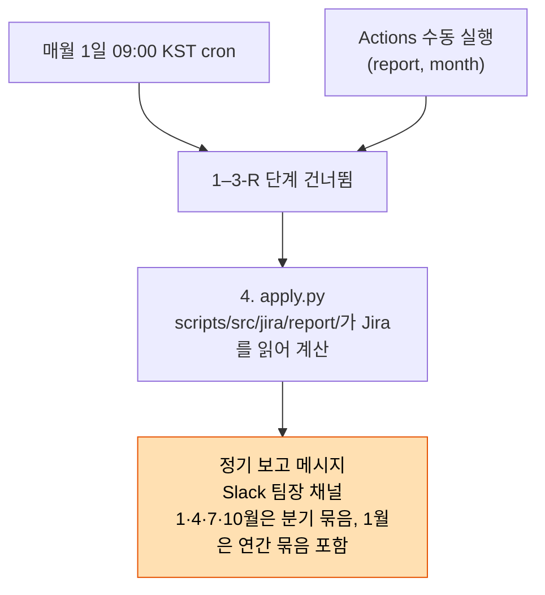
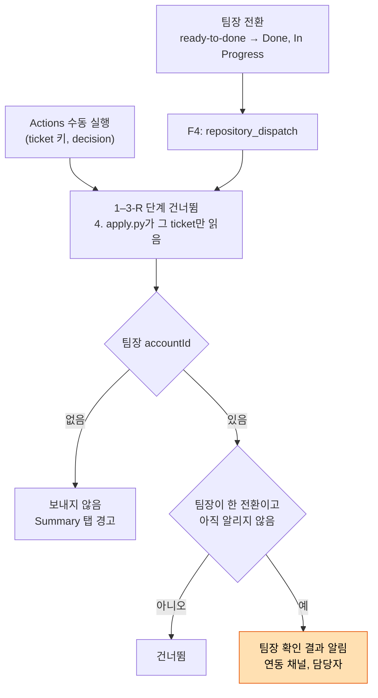
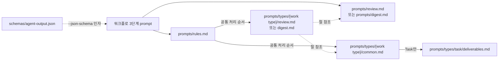

# jira-doc: AI팀 업무 문서화 agent 동작 흐름, 알림, 운영

jira-doc은 AI팀 업무 문서화 agent다.
Jira ticket의 결과 문서를 작성하고 검수한다.
결과 문서의 근거는 ticket의 기록이다(`prompts/rules.md`의 "입력 파일" 절).

- 결과 문서: jira-doc이 Jira와 Slack에 남기는 문서
  - Jira에 남기는 것
    - TL;DR, 결과 산출물 구역
    - 검수 comment, 문서화 리뷰 comment
  - 연동 채널: 검수 뒤 Slack 알림, 실패 알림(보고 모드 제외), 주간 점검 메시지
    - secret `SLACK_WEBHOOK_URL`의 Slack 채널
  - 팀장 채널: 토큰(인증 키) 만료 알림, 정기 보고 메시지, 보고 모드의 실패 알림
    - secret `SLACK_LEAD_WEBHOOK_URL`의 Slack 채널
- ticket의 기록: 사람이 남긴 기록
  - comment, sub-task, PR(pull request)

- jira-doc은 아래 다섯 실행 모드로 실행된다(`.github/workflows/jira-doc.yml`의 `MODE`).
  - 검수 모드: 담당자가 완료를 요청한 ticket을 검수한다.
    - ticket 상태는 바꾸지 않는다.
      - 팀장이 검수 결과를 확인한 뒤 직접 전환한다.
  - 정리 모드: ticket의 TL;DR과 결과 산출물 구역을 다시 작성한다.
    - TL;DR: ticket의 요약을 담는 Jira 필드
    - 결과 산출물 구역: Task description 안의 `h2. 결과 산출물` 구역
  - 주간 점검 모드: 누락 항목을 Slack 메시지 한 건으로 보고한다.
    - 누락 항목: stop 사유 없음, 오래 활동 없음 같은 기록 누락
    - 토큰(인증 키) 만료 30일 전부터 팀장 채널로 알린다.
  - 보고 모드: 지난달 정기 보고 메시지를 팀장 채널로 보낸다.
  - 확인 결과 알림 모드: 팀장이 ticket을 전환하면 담당자에게 Slack을 보낸다.
    - 전환: ready-to-done에서 Done(통과) 또는 In Progress(보류)
- 알림은 즉시, 주간, 월간, 분기, 연간의 다섯 주기로 나간다.
  - 정기 실행은 수요일 cron과 매월 1일 cron 둘이다(`.github/workflows/jira-doc.yml:14-15`).
    - cron: 정해진 시각에 Actions 워크플로를 실행하는 일정
  - 알림 목록과 지표 정의는 `docs/jira-doc-agent/alerts.md`에 있다.
- 독자별로 읽을 절은 아래와 같다.
  - 담당자: "용어"부터 "work type별 동작 흐름"까지
  - 팀장: 문서 전체
    - 팀장용 절은 "구성 파일, CI agent 설정, 스크립트 계산 값" 절부터 시작한다.

## 용어

이 문서는 아래 용어를 한 이름으로만 사용한다.

- ticket: Jira에 등록된 업무 하나(`prompts/rules.md:10`)
  - work type과 관계없이 부르는 이름이다.
- work type: ticket의 종류
  - jira-doc은 Task, Bug, Issue를 다룬다(`scripts/src/constant/jira.py`의 `TARGET_TYPES`).
  - "Task"는 work type Task만 가리킨다.
- 담당자: ticket의 assignee
  - Bug의 사람 구역은 제보자가 작성한다.
  - Issue의 사람 구역은 제기자가 작성한다.
  - 근거: `prompts/types/<work type>/common.md`의 "ticket 구조"
- 팀장: 검수 결과를 확인하고 ticket을 Done으로 전환하는 사람
  - Jira accountId는 variable `JIRA_LEAD_ACCOUNT_ID`에 있다.
- 사람 구역과 agent 구역: ticket의 내용을 작성 주체로 나눈 두 구역(`prompts/rules.md:17-19`)
  - 사람 구역: 담당자가 작성하는 description 구역
  - agent 구역: CI agent의 출력으로 채우는 구역(TL;DR, 결과 산출물 구역)
  - CI agent와 스크립트는 사람 구역을 고치지 않는다(`prompts/rules.md:20`).
- CI agent: Actions 워크플로 3단계에서 실행되는 Claude
  - 파일을 작성하지 않고 구조화 출력(JSON)만 낸다(`prompts/rules.md`의 "출력" 절).
- 지시 파일: CI agent가 읽는 `prompts/` 아래 파일
  - work type 검수 파일: `prompts/types/<work type>/review.md`
  - work type 정리 파일: `prompts/types/<work type>/digest.md`
  - 전체 목록은 "파일 목록" 절에 있다.
- 실행 모드: jira-doc을 실행하는 방식
  - 괄호 안은 Actions 워크플로 입력 `mode`의 값이다.
  - 검수 모드(review), 정리 모드(digest)
  - 주간 점검 모드(alerts), 보고 모드(report)
  - 확인 결과 알림 모드(decision)
- Jira 워크플로: ticket의 상태와 상태 사이 전환의 체계
- Jira 전환: ticket 상태를 바꾸는 Jira 동작
  - 이름과 도착 상태는 INNO 프로젝트 ticket의 전환 목록과 같다.
    - 터미널에서는 `scripts/jira.sh transitions <ticket 키>`로 조회한다.
  - request 전환: 담당자가 ticket을 ready-to-done으로 보내는 전환
    - 출발 상태는 In Progress다.
  - stop 전환: 진행 중인 ticket을 Backlog로 보내는 전환
    - precheck.py는 Backlog로 가는 모든 상태 변경을 stop으로 센다(`scripts/src/jira/precheck/history.py`의 `stop_events`).
  - `end` 전환: 팀장이 ticket을 ready-to-done에서 Done으로 보내는 전환
- repository_dispatch: Actions 워크플로를 시작하는 이벤트
  - 외부 서비스가 GitHub API로 보낸다.
  - 이벤트의 종류 값으로 실행 모드가 정해진다(Actions 워크플로의 `MODE`).
- F1, F2, F3, F4: jira-doc과 연결된 Jira Automation
  - Jira Automation: Jira의 자동화 규칙
  - F1: request 전환 때 repository_dispatch(종류 `jira-doc-review`)를 보낸다.
    - Actions 워크플로가 검수 모드로 실행된다.
    - 근거: INNO-29의 request 전환으로 실행 `36821640590`이 생겼다(`gh run list --repo everex-ai/.github --workflow jira-doc.yml`).
  - F2(stop 사유 요청): stop 전환 때 담당자를 멘션한 안내 comment를 단다.
    - GitHub와는 관계없다.
    - 출처: Jira Automation F2 설정
      - 이 repo의 코드에는 없다.
    - 안내 comment의 문구는 아래 두 줄이다.
      - `현재 티켓을 Backlog로 이동시킴(stop 전환). 이유와 재시작 시점에 대한 사유를 아래 comment에 남겨야 함.`
      - `다시 In Progress로 상태를 변경한 이후에 사유를 남길 때는 "stop 사유:"로 시작하는 comment를 남겨야 사유로 인정됨`
    - F2의 안내 comment는 stop 사유로 세지 않는다(`scripts/src/jira/wiki.py`의 `is_agent_comment`).
  - F3(문서 정리 지금 실행): ticket 화면의 버튼으로 실행한다.
    - 버튼 위치: ticket 화면의 Automation(번개) 버튼
    - 출처: Jira Automation F3 설정
    - repository_dispatch(종류 `jira-doc-manual`)를 보내 정리 모드로 실행한다.
  - F4(팀장 확인 결과 알림): 팀장의 전환 때 실행된다.
    - 전환: ready-to-done ticket을 다른 상태로 바꾸는 전환
    - 대상 전환: Done(통과), In Progress(보류)
    - repository_dispatch(종류 `jira-doc-decision`)를 보내 확인 결과 알림 모드로 실행한다.
    - 만드는 방법은 "설치" 절 3번에 있다.
- stop 사유: stop 전환 뒤 담당자가 남기는 중단 이유 comment
  - 세는 규칙은 "보류 뒤 다시 검수받는 방법" 절에 있다.
- 검사 ID: T1, R4처럼 검사 항목에 붙인 코드
  - 앞 글자 T, B, I는 검사 대상 work type(Task, Bug, Issue)이다.
  - R과 A는 여러 work type에 적용하는 검사다.
  - 이름과 검사 내용은 아래 두 곳의 검사 항목 표에 있다.
    - 공통 검사(R2, R3, R4): `prompts/review.md`의 "공통 검사 항목" 표
    - work type별 검사: `prompts/types/<work type>/review.md`(work type 폴더는 task, bug, issue)
  - A1, A3는 누락 알림에만 사용하는 검사다.
    - A1: In Progress ticket에 영업일 기준 5일 이상 사람의 활동이 없음
    - A3: ready-to-done에 영업일 기준 3일 이상 머묾
    - 계산 세부는 "스크립트가 계산하는 값" 절에 있다.
- 검사 결과 값: 만족, 보완 필요, 해당 없음(`scripts/src/constant/check.py`의 `RESULT_KO`)
- 검수 결과: 통과, 검토 요청, 보류
  - 세부는 "검수 결과와 ticket 상태 전환" 절에 있다.
- 누락 알림: 기록 누락을 담당자나 팀장에게 알리는 알림
  - 주간 점검 메시지(Slack)로 보낸다.
- 스크립트 검사: CI agent의 판단 없이 precheck.py가 규칙대로 계산하는 검사
- CI agent 검사: CI agent가 기록을 읽고 판단하는 검사
- 문서화 리뷰: 담당자의 기록 습관을 검사하는 검사 항목
  - 항목은 Task T4–T9, Bug B5–B7, Issue I4–I5다(`scripts/src/constant/check.py`의 `DOC_CHECKS`).
- 관찰 모드와 게이트 모드: 문서화 리뷰 결과를 다루는 두 방식
  - variable `JIRA_DOC_GATE`가 `false`이면 관찰 모드, `true`이면 게이트 모드다(`scripts/apply.py`의 `main`).
  - 관찰 모드: 결과를 팀장용 문서화 리뷰 comment로만 공유한다.
    - 검수 결과에는 넣지 않는다.
  - 게이트 모드: 결과를 담당자용 검수 comment에 넣는다.
    - 보완 필요 항목이 있으면 통과를 보류로 바꾼다.
    - 팀장용 문서화 리뷰 comment는 게시하지 않는다.
- 영업일: 토요일과 일요일만 뺀 날
  - 공휴일은 빼지 않는다(`scripts/src/jira/precheck/history.py`의 `business_days_since`).
- jira-doc 기록: ticket마다 저장하는 Jira issue property `ai-doc-agent`
  - 들어 있는 값은 아래 일곱 가지다(`scripts/src/jira/issue.py`의 `apply_issue`, `apply_decision`).
    - 실행: 마지막 실행 시각, 마지막 실행 모드(`lastMode`), 사람 입력의 해시
    - 검수: 마지막 검수 결과, 문서화 리뷰 보완 필요 항목(`docFails`)
    - 기록: 실행 기록 `runs`, 알린 팀장 전환 시각(`lastDecisionAt`)
    - 마지막 실행 시각, 사람 입력의 해시
      - 사람 입력: 사람 구역, 사람 comment, sub-task, PR, 상태 전환(`scripts/src/jira/collect.py`의 `HUMAN_SECTIONS`)
    - 마지막 검수 결과
    - 실행 기록 `runs`: 실행마다 Claude 사용량을 담은 항목. 최근 100건
      - 항목은 `docs/jira-doc-agent/alerts.md`의 "Claude 사용량 기록" 절에 있다.
  - 예전 실행이 남긴 `notified`(보낸 누락 알림 코드)가 더 있을 수 있다.
    - 지금은 사용하지 않는다.
- Summary 탭: GitHub Actions 실행 화면의 요약 탭
  - apply.py가 ticket별 결과 표를 남긴다(`scripts/src/common/github.py`의 `Summary`).

## 전체 동작 흐름

jira-doc은 Jira 전환(F1, F4), F3 버튼, cron 두 개로 실행된다.
cron은 수요일과 매월 1일에 실행된다.

### ticket 상태와 jira-doc 실행 시점

- ticket 상태 순서대로 jira-doc이 실행되는 시점은 아래와 같다.
  1. To Do에서 In Progress: jira-doc은 실행되지 않는다.
     - 첫 In Progress 전환은 작업 기간의 시작으로 기록된다(`scripts/src/jira/precheck/history.py`의 `doc_facts`).
  2. In Progress 동안: 담당자가 기록을 남긴다.
     - 담당자가 F3 버튼을 누르면 정리 모드가 실행된다.
     - 사람의 활동이 오래 없으면 주간 점검 메시지에 올라간다(A1).
  3. stop 전환: F2가 사유 요청 comment를 단다.
     - 24시간이 지나도 사유가 없으면 주간 점검 메시지에 올라간다(R4, `scripts/src/jira/precheck/run.py`의 `run_scan`).
  4. request 전환: F1이 검수 모드를 실행한다.
     - 검수 과정은 아래 "검수 모드 처리 과정" 절에 있다.
  5. 검수 뒤: 검수 결과와 관계없이 ticket은 ready-to-done에 머문다.
     - 검수 뒤 Slack 알림이 팀장에게 간다.
     - 팀장이 검수 comment를 확인한 뒤 직접 전환한다.
       - 보류는 In Progress, 통과는 Done으로 전환한다.
     - 전환하면 F4가 담당자에게 팀장 확인 결과 알림을 보낸다.
     - 세부: "검수 결과와 ticket 상태 전환" 절
  6. ready-to-done 동안: 오래 머물면 주간 점검 메시지에 올라간다(A3).
     - A3는 팀장을 멘션한다.
  7. ready-to-done에서 Done(`end` 전환): 팀장이 확인한 뒤 직접 전환한다.
     - apply.py는 `end` 전환을 실행하지 않는다(`scripts/src/constant/check.py`의 `STATE_NOTE`).

### 실행 모드

주기 실행은 주간 점검 모드와 보고 모드다.
검수 모드와 정리 모드는 Jira Automation이나 수동 실행으로 시작한다.
두 모드는 ticket 키가 필수다.

| 실행 모드 | 시작 | 하는 일 | CI agent |
|---|---|---|---|
| 검수 모드(review) | F1, Actions 수동 실행(ticket 키 필수) | TL;DR, 결과 산출물 구역(Task만), 검수 comment, 문서화 리뷰 comment(관찰 모드), Slack 알림 | 실행 |
| 정리 모드(digest) | F3, Actions 수동 실행(ticket 키 필수) | 그 ticket의 TL;DR과 결과 산출물 구역을 지금까지의 기록으로 다시 작성. comment와 검수 결과 없음 | 실행 |
| 주간 점검 모드(alerts) | 매주 수요일 09:00 KST(한국 표준시) cron, Actions 수동 실행 | 누락 항목(R4, A1, A3)을 Slack 메시지 한 건으로 보고. 토큰(인증 키) 만료 30일 전부터 팀장 채널로 알림 | 실행하지 않음 |
| 보고 모드(report) | 매월 1일 09:00 KST cron, Actions 수동 실행(`month` 입력) | 지난달(또는 `month`)의 정기 보고 메시지를 팀장 채널로 보냄 | 실행하지 않음 |
| 확인 결과 알림 모드(decision) | F4, Actions 수동 실행(ticket 키 필수) | 팀장의 전환 결과를 담당자에게 연동 채널로 알림 | 실행하지 않음 |

- 이 표의 근거는 아래와 같다.
  - `scripts/collect.py`의 `main`
  - `scripts/src/jira/issue.py`의 `apply_issue`, `slack_weekly`, `scripts/apply.py`의 `main`
  - `scripts/src/jira/report/run.py`의 `run_report`
  - Actions 워크플로의 `schedule`, `MODE`, 각 스텝의 `if`
- 정리 모드를 ticket 키 없이 실행하면 1단계가 종료 코드 1로 끝난다(`scripts/collect.py`의 `main`).
  - Actions 실행 상태가 failure로 표시된다.
  - 5단계 실패 알림이 원인 "기록 없음"으로 나간다.
    - 5단계: 앞 단계가 실패하면 실행되는 알림 단계(아래 "실행 실패 알림(5단계)" 절)
  - 예전에는 최근 3일 안에 바뀐 ticket을 모아 정리했다.
    - 누락 알림 comment도 게시했다.
    - 2026-10 알림 체계 재구성 때 없앴다(근거: commit `b9a7e28`의 `scripts/collect.py`의 `main`).

### 검수 모드 처리 과정

request 전환부터 ticket 갱신까지 아래 단계가 차례로 실행된다.
스크립트, CI agent, 스크립트 순서로 입력과 출력을 넘긴다.

- 단계 이름은 Actions 워크플로의 스텝 이름(`.github/workflows/jira-doc.yml`의 `name:`)이다.
- docFacts: CI agent가 문서화 리뷰를 판단할 때 인용하는 수치(`scripts/src/jira/precheck/history.py`의 `doc_facts`)

| 단계 | 실행 주체 | 입력 | 출력 |
|---|---|---|---|
| 시작 | F1(Jira Automation) | request 전환 | repository_dispatch(종류 `jira-doc-review`) |
| 1. 입력 수집 | `scripts/collect.py` | Jira ticket, GitHub PR | `ctx/<ticket 키>/`의 issue.json, description.wiki, tldr.txt, comments.json, changelog.json, subtasks/*.json, prs.json, meta.json |
| 2. 결정론적 검사 (precheck) | `scripts/precheck.py` | 1단계의 `ctx/` 파일 | `ctx/<ticket 키>/precheck.json`(스크립트 검사 결과 `checks`, stop 이력 `stops`, docFacts, Task의 예상 산출물 목록 `expected`) |
| 3-0. 스키마 준비 | Actions 워크플로 | `schemas/agent-output.json` | 3단계에 넘기는 한 줄 JSON |
| 3. Claude 문서화 | CI agent | `ctx/` 파일, 지시 파일(`prompts/`) | 구조화 출력: ticket별 판정 객체(`verdict`), TL;DR 본문(`tldr`), 검수 comment의 결과 요약(`comment`), 처리하지 못한 ticket(`failed`) |
| 3-1. Claude 실행 결과 요약 | `scripts/save_output.py --exec-summary` | CI agent 실행 결과 파일 | 로그 줄(`is_error`, 턴 수, 비용, 토큰 수, 거부된 도구) |
| 3-2. 출력 저장 | `scripts/save_output.py` | 구조화 출력, precheck.json, CI agent 실행 결과 파일 | `out/<ticket 키>/`의 verdict.json, tldr.wiki, comment.wiki, `_agent_error.txt`, `out/_usage.json`(Claude 사용량). 빠진 부분이 있으면 `retry=true` |
| 3-R. 다시 실행 | CI agent, `scripts/save_output.py` | 3단계, 3-2 단계와 같음 | `out/` 파일을 덮어씀 |
| 4. 반영 | `scripts/apply.py` | `ctx/` 파일, `out/` 파일 | Jira 반영, Slack 알림, Summary 탭 |
| 5. 실패 알림 | `scripts/apply.py --mode failure` | `out/_run_error.json`, `out/_failure_notified` | 앞 단계가 실패했을 때만 연동 채널로 실패 알림(보고 모드는 팀장 채널) |

- 이 표의 근거는 아래와 같다.
  - 1단계: `scripts/src/jira/collect.py`의 `collect_issue`, `prompts/rules.md`의 "입력 파일" 절
  - 2단계: `scripts/src/jira/precheck/run.py`의 `run_issue_dir`
  - 3단계: Actions 워크플로 3단계의 `prompt`, `claude_args`, `prompts/rules.md`의 "출력" 절
  - 3-2 단계: `scripts/src/jira/output/save.py`의 `save_task`, `missing_parts`
  - 4단계: `scripts/src/jira/issue.py`의 `apply_issue`
- 판정 객체는 CI agent의 판정을 담는다(`schemas/agent-output.json`).
  - 내용: 검수 결과, 검사 결과, 예상 산출물별 달성 여부
  - 검수 모드에서는 Slack 요점(`slack`)도 담는다.
    - 요점: 검수 결과의 이유를 적는 글머리표 줄
    - 메시지 틀: `docs/jira-doc-agent/alerts.md`의 "Slack 알림 메시지 구조" 절
- 3-R 단계는 검수 모드에서 3-2 단계가 `retry=true`를 출력했을 때만 실행된다.
  - 빠진 부분은 아래 넷 중 하나다(`scripts/src/jira/output/save.py`의 `missing_parts`).
    - 판정 없음, items의 `done` null, 빈 `tldr`, 빈 `comment`
    - items: 판정 객체 안의 예상 산출물별 결과 목록
  - 정리 모드는 다시 실행하지 않는다.
  - 3-R 실행에는 3-1 단계 같은 실행 결과 요약 단계가 없다(`.github/workflows/jira-doc.yml:131-155`).
- 4단계의 apply.py는 ticket마다 아래 순서로 처리한다(`scripts/src/jira/issue.py`의 `apply_issue`).
  1. verdict.json, tldr.wiki, comment.wiki, `_agent_error.txt`를 검사한다.
     - 문제가 있으면 실패로 처리하고 Jira에 반영하지 않는다("실패 처리" 절).
  2. 검수 결과를 다시 정한다("`scripts/apply.py`가 검수 결과를 다시 정하는 경우" 절).
  3. Task이면 결과 산출물 구역을 조립한다(`deliverables_wiki`).
  4. description의 결과 산출물 구역과 TL;DR 필드를 한 번에 갱신한다(`scripts/src/jira/client.py`의 `set_fields`).
  5. 검수 comment를 게시한다(`review_comment`).
  6. 관찰 모드이면 문서화 리뷰 comment를 게시한다(`doc_review_comment`).
  7. jira-doc 기록을 저장한다. 이 실행의 Claude 사용량을 `runs`에 추가한다.
     - `runs`의 항목은 `docs/jira-doc-agent/alerts.md`의 "Claude 사용량 기록" 절에 있다.
  8. 검수 뒤 Slack 알림을 보낸다(`review_slack_text`).
  9. Summary 탭에 결과 행을 남긴다.
  - ticket 상태는 바꾸지 않는다.
    - 2026-10 알림 체계 재구성 전에는 보류이면 In Progress로 되돌렸다.
    - 근거: commit `b9a7e28`의 `scripts/apply.py`의 `review_transition`
- 다른 실행 모드에서 달라지는 단계는 아래와 같다.
  - 정리 모드: 3-R 단계가 없다.
    - 4단계에서 comment, 상태 전환, 검수 뒤 Slack 알림이 없다.
    - Task의 결과 산출물 구역은 예상 산출물과 1:1로 대응할 때만 갱신한다(`scripts/src/jira/issue.py`의 `apply_issue`).
  - 주간 점검 모드: 1단계는 누락 검사용 요약만 모으고, 3단계 전체를 건너뛴다.
    - 누락 검사용 요약: ticket 전체의 상태와 활동 요약(`scripts/src/jira/collect.py`의 `collect_scan`)
      - 대상: Done, Deleted가 아닌 ticket
    - 4단계는 Jira에 기록하지 않고 Slack 메시지만 보낸다(`scripts/apply.py`의 `main`).
  - 보고 모드: 1–3-R 단계를 모두 건너뛴다.
    - 4단계가 Jira를 읽어 정기 보고 메시지를 만들고 팀장 채널로 보낸다(`scripts/src/jira/report/run.py`의 `run_report`).
  - 단계별 분기는 "실행 모드별 흐름도" 절에 있다.

## 검수 결과와 ticket 상태 전환

검수 결과는 통과, 검토 요청, 보류 셋이다.
jira-doc은 ticket 상태를 바꾸지 않는다.
팀장이 검수 comment를 확인한 뒤 직접 전환한다.

### 검수 결과별 상태

- 검수 결과별 ticket 상태와 다음에 할 사람은 아래 표와 같다.

| 검수 결과 | 조건 | 상태 | 다음에 할 사람 |
|---|---|---|---|
| 통과(pass) | work type의 완료 판단 기준을 충족하고, 필수 검사(보완 필요일 때 보류나 검토 요청으로 이어지는 검사)가 모두 만족 | ready-to-done 유지 | 팀장. 확인한 뒤 Done으로 직접 전환 |
| 검토 요청(escalate) | 팀장 판단이 필요함(예: 미달성 항목마다 담당자의 사유가 있음, 완료 기준이 ready-to-done 뒤 바뀜, 근거끼리 모순) | ready-to-done 유지 | 팀장. 확인한 뒤 In Progress나 Done으로 직접 전환 |
| 보류(fix) | 담당자가 고칠 수 있는 누락이 있음(예: 사람 구역 누락, stop 사유 없음, 근거 링크 없음, 사유 없는 미달성 항목) | ready-to-done 유지 | 팀장. 확인한 뒤 In Progress로 직접 전환. 그 뒤 담당자가 요청대로 기록하고 다시 request 전환 |

- 괄호 안은 검수 결과 코드값(`verdict.verdict`)이다(`prompts/review.md`의 "검수 결과 코드값의 공통 기준").
- work type별 조건은 아래 두 곳에 있다.
  - "work type별 동작 흐름" 절
  - work type 검수 파일의 "검수 결과" 절
- 모든 검수 결과에서 apply.py는 상태를 바꾸지 않는다(`scripts/src/constant/check.py`의 `STATE_NOTE`).
  - 검수 comment와 Slack 알림에 상태 처리 문구가 적힌다.
    - 문구: `상태를 바꾸지 않고 팀장 확인을 요청함`
  - 검수 뒤 Slack 알림은 검수 결과와 관계없이 팀장만 멘션한다.
  - 담당자는 팀장이 전환한 뒤 팀장 확인 결과 알림으로 결과를 받는다(`scripts/src/jira/issue.py`의 `apply_decision`).
- 보류를 자동으로 되돌리지 않는 이유는 팀장의 판단을 전환 기록으로 남기기 위해서다.
  - 팀장의 전환 기록으로 판정 일치율을 계산한다.
    - 판정 일치율: Agent 판정과 팀장 판단이 같은 비율
    - 정의: `docs/jira-doc-agent/alerts.md`의 "판정 일치율" 절

### `scripts/apply.py`가 검수 결과를 다시 정하는 경우

apply.py는 CI agent가 정한 검수 결과를 다시 정한다.
기준은 스크립트 검사 결과와 아래 규칙이다.

- 모든 work type에 적용하는 규칙은 아래와 같다(`scripts/src/jira/issue.py`의 `apply_issue`).
  - 스크립트 검사 결과가 CI agent의 값보다 우선한다.
  - 완료 기준의 사후 변경 (A2)이 보완 필요이면 검토 요청으로 바꾼다.
    - A2는 Task와 Bug만 계산한다(`scripts/src/jira/precheck/run.py`의 `run_issue_dir`).
  - 아래 검사 중 보완 필요가 있으면 통과를 보류로 바꾼다.
    - T1, T2, B1, B2, I1, I2, R4
  - 게이트 모드에서 문서화 리뷰에 보완 필요가 있으면 통과를 보류로 바꾼다.
- Task에만 적용하는 규칙은 아래와 같다.
  - 예상 산출물과 결과 산출물의 1:1 대응 (T3)이 맞지 않으면 검토 요청으로 바꾼다(`apply_issue`).
  - 미달성 항목이 있으면 `recheck_verdict`가 아래처럼 바꾼다.
    - 검토 요청으로 바꾸는 조건은 아래 셋을 모두 만족할 때다.
      - 미달성 항목마다 담당자의 사유가 있다.
      - 담당자가 고칠 수 있는 검사(`OWNER_FIXABLE_CHECKS`)에 보완 필요가 없다.
        - Task의 해당 검사: T1, T2, R2, R4
      - 게이트 모드라면 문서화 리뷰에 보완 필요가 없다.
    - 위 조건을 만족하지 않는데 통과이면 보류로 바꾼다.
- 아래 검사는 CI agent의 판단을 그대로 사용한다.
  - 대상 검사
    - 원인과 해결의 근거 링크 (B3), To-Be 동작 확인 comment (B4)
    - 대응 결과의 근거 (I3)
    - Bug, Issue의 1년 뒤에도 이해 가능한 기록 (R2)
  - 근거: `scripts/src/jira/issue.py`의 `apply_issue`가 다시 정하는 검사에 없다.
- "근거 부족으로 확인 불가"는 담당자의 사유로 세지 않는다(`scripts/src/jira/verdict.py`의 `owner_reason`).
  - CI agent가 근거를 찾지 못했다는 표시이기 때문이다.
  - 초과 달성·미달성 사유 (T8) 판정도 같은 기준으로 센다(`scripts/src/jira/verdict.py`의 `check_t8`).
- 바꾼 이유는 검수 comment의 검수 결과 줄 아래에 적힌다(`scripts/src/jira/comment.py`의 `review_comment`).

### 보류 뒤 다시 검수받는 방법

먼저 팀장이 보류 ticket을 In Progress로 되돌린다.
그 뒤 담당자가 요청대로 기록하고 다시 request 전환한다.
그러면 F1이 다시 검수한다. 미달성 항목이면 사유를 comment로 남긴다.

- stop 사유 없이 다시 진행한 ticket은 R4가 보완 필요가 된다.
  - 그래서 검수 결과가 보류가 된다(`scripts/src/jira/precheck/history.py`의 `check_r4`).
- precheck.py가 stop 사유로 세는 comment는 아래 두 가지다(`scripts/src/jira/precheck/history.py`의 `stop_events`).
  - stop 뒤 다음 상태 변경 전까지 사람이 남긴 comment
  - 늦은 사유: 다음 상태 변경 뒤에 남긴, "stop 사유:"로 시작하는 사람 comment
    - 늦은 사유는 stop 뒤 언제 남겼든 그 stop의 사유로 센다.
- "stop 사유:" 머리말을 요구하는 이유는 진행 상황 comment와 구분하기 위해서다.
  - 다시 진행한 뒤의 진행 상황 comment를 stop 사유로 세지 않는다(`scripts/src/jira/precheck/history.py`의 `stop_events`).
- 보류의 요청에는 아래 문장이 들어간다(`scripts/src/jira/issue.py`의 `apply_issue`).
  - `stop(<날짜>)의 사유를 'stop 사유:'로 시작하는 comment로 남긴 뒤 다시 request 전환 필요`
- 늦은 사유를 남기고 다시 request 전환하면 R4는 만족이 된다.
  - 검사 표의 R4 내용 칸에 아래가 표시된다(`scripts/src/jira/precheck/history.py`의 `check_r4`).
    - "늦게 기록", stop 날짜, 늦은 사유 comment 링크
  - 검수 결과는 R4가 만족인 상태에서 "검수 결과별 상태" 절의 표대로 정해진다.
  - 통과와 검토 요청의 Slack 알림에도 "늦게 기록" 줄이 들어간다(`scripts/src/jira/slack.py`의 `review_slack_reasons`).

## Jira에 남는 결과 문서

이 절은 결과 문서 중 Jira ticket에 남는 아래 네 가지의 구성을 다룬다.

- TL;DR, 결과 산출물 구역
- 검수 comment, 문서화 리뷰 comment
- Slack 메시지는 `docs/jira-doc-agent/alerts.md`에 있다.

- jira-doc의 모든 comment는 첫 줄이 `[ai-doc-agent]`다(`scripts/src/jira/comment.py`의 `agent_comment`).
  - 스크립트는 이 표식과 Automation 작성자로 사람의 comment와 구분한다(`scripts/src/jira/wiki.py`의 `is_agent_comment`).
  - 팀장이 직접 작성하는 comment에는 이 표식을 넣지 않는다.
- TL;DR과 결과 산출물 구역은 실행 때마다 통째로 다시 작성된다(`scripts/src/jira/wiki.py`의 `set_section`).

### TL;DR

- TL;DR은 ticket의 custom field에 들어간다.
  - 필드 ID는 variable `JIRA_TLDR_FIELD_ID`(`customfield_10650`)다.
  - Jira 기본 필드인 요약(Summary)과 다른 필드다.
- 형식은 work type마다 다르다(`prompts/types/<work type>/common.md`의 "tldr 형식").
  - Task: `h2. Summary` 아래 결과 목록
  - Bug: `h2. Summary` 아래 `h3. 원인`, `h3. 해결`
  - Issue: `h2. Summary` 아래 대응 결과 목록
- CI agent는 마지막 줄에 상태, 검수 결과, 갱신 시각을 회색으로 적는다.
  - 정리 모드에서는 검수 결과를 적지 않는다.
  - 근거: `prompts/types/<work type>/common.md`의 "tldr 형식"

### 결과 산출물 구역

- 결과 산출물 구역은 Task에만 있는 agent 구역이다.
  - 위치: description 안의 `h2. 결과 산출물` 구역
  - apply.py는 description에서 이 구역만 바꾼다(`scripts/src/jira/wiki.py`의 `set_section`).
- 구성은 아래와 같다(`scripts/src/jira/comment.py`의 `deliverables_wiki`).
  - 회색 안내 줄 다음에 달성 요약("예상 산출물 3개 중 1개 달성") 한 줄이 나온다.
  - 예상 산출물 순서대로 달성 여부, 결과, 근거가 붙는다.
  - 미달성 항목에는 "미달성 사유"가 붙는다.
    - CI agent가 요청을 작성했으면 "요청"이 붙는다.
  - 예상에 없던 결과는 "초과 달성"에 "추가 사유"와 함께 따로 나온다.
- apply.py는 기록에 사유가 없으면 검수 모드에서만 "사유 미기재"로 표시한다.
  - 정리 모드에서는 표시하지 않는다.
    - 이유: 진행 중이라 사유가 아직 없을 수 있다.
  - apply.py는 초과 달성·미달성 사유 (T8) 판정도 검수 모드에서만 한다.
- F3로 정리하면 회색 안내 줄 끝에 `(F3 정리: Jira ticket 화면의 문서 정리 버튼)`이 붙는다(`scripts/src/jira/issue.py`의 `apply_issue`).

### 검수 comment

- 검수 comment는 검수 모드에서 실행마다 하나씩 게시된다(`scripts/src/jira/issue.py`의 `apply_issue`).
- 구성 순서는 아래와 같다(`scripts/src/jira/comment.py`의 `review_comment`).
  1. 검수 결과 줄
  2. apply.py가 CI agent의 검수 결과를 바꾼 이유와 상태 처리
  3. 달성 요약, 결과 요약, 요청
  4. 검사 표
  5. 멘션: 검토 요청은 팀장, 통과와 보류는 담당자
- 검사 표는 "예상 산출물 작성 (T1)"처럼 이름과 ID를 함께 표시한다.
  - 순서는 `scripts/src/constant/check.py`의 `CHECK_NAMES` 순서로 고정이다.
- 결과 칸은 ✅ 만족, ❌ 보완 필요, ➖ 해당 없음 중 하나다(`scripts/src/constant/check.py`의 `RESULT_KO`).
- 검수 결과를 바꾼 이유에 나오는 검사도 이름과 ID를 함께 표시한다.
  - 예: "완료 기준의 사후 변경 (A2)"

### 문서화 리뷰 comment

- 문서화 리뷰 comment는 관찰 모드의 검수 모드에서만 게시된다(`scripts/src/jira/comment.py`의 `doc_review_comment`).
  - 문서화 리뷰 항목이 하나도 없으면 게시하지 않는다(`scripts/src/jira/issue.py`의 `apply_issue`).
  - Bug와 Issue는 CI agent가 항목을 내지 않으면 이 경우가 된다.
- 구성은 아래와 같다.
  - 둘째 줄: `문서화 리뷰 결과(관찰 모드):` 뒤에 통과나 보완 필요가 굵게 표시된다.
  - 문서화 리뷰 항목의 검사 표와 항목별 피드백
    - 항목은 "work type별 동작 흐름" 절의 비교 표에 있다.
  - 담당자에게 보낼 요청 후보
    - 게이트 모드였다면 검수 comment의 요청에 들어갈 문장이다.
  - 팀장 멘션
- Summary 탭에는 문서화 리뷰 결과 제목 줄과 검사 표만 나온다(`scripts/src/jira/comment.py`의 `doc_review_md`).
- 게이트 모드에서는 이 comment를 게시하지 않는다.
  - 근거: "용어" 절의 관찰 모드와 게이트 모드

### 결과 문서를 고치는 방법

- 담당자는 고칠 내용을 "정정:"으로 시작하는 comment로 남긴다.
  - CI agent는 "정정:" comment를 원래 근거보다 우선한다.
    - 근거: `prompts/rules.md`의 "입력 파일" 절
- 바로 반영하려면 ticket 화면에서 F3 버튼을 누른다.
  - TL;DR과 결과 산출물 구역이 함께 다시 작성된다(`prompts/digest.md:3`).
- 사람 구역은 담당자가 직접 고친다.
  - CI agent는 검수 comment에서 지적만 한다(`prompts/rules.md:20`).

## 알림 체계

알림의 주기, 받는 사람, 내용, 지표 정의는 `docs/jira-doc-agent/alerts.md`에 있다.

## 실행 모드별 흐름도

실행 모드마다 단계와 분기, 알림이 나가는 지점을 흐름도로 그렸다.

- 주황 노드가 알림이다.
- 어느 실행 모드든 단계가 실패하면 5단계 실패 알림이 나간다.
  - 세부는 아래 "실행 실패 알림(5단계)" 절에 있다.
  - 흐름도에는 그리지 않았다.

### 검수 모드 흐름도

| 분기나 노드 | 근거 |
|---|---|
| 판정이나 문장이 빠졌는지 | `scripts/src/jira/output/save.py`의 `missing_parts`, Actions 워크플로 3-R 단계의 `if` |
| 출력 검사 | `scripts/src/jira/issue.py`의 `apply_issue`, `scripts/src/jira/verdict.py`의 `validate_verdict` |
| 검수 결과 다시 정함 | "`scripts/apply.py`가 검수 결과를 다시 정하는 경우" 절 |
| 상태 유지 | `scripts/src/constant/check.py`의 `STATE_NOTE` |
| 알림 노드 | `docs/jira-doc-agent/alerts.md`의 "주기별 알림" 절 |

### 정리 모드 흐름도

| 분기나 노드 | 근거 |
|---|---|
| ticket 키 지정과 없음 | `scripts/collect.py`의 `main` |
| 결과 산출물 구역 갱신 조건 | `scripts/src/jira/issue.py`의 `apply_issue` |
| 3-R 단계 없음 | Actions 워크플로 3-R 단계의 `if`(검수 모드만) |

### 주간 점검 모드 흐름도

| 분기나 노드 | 근거 |
|---|---|
| 누락 검사용 요약 수집 | `scripts/src/jira/collect.py`의 `collect_scan` |
| 결정론적 검사(R4, A1, A3 계산) | `scripts/src/jira/precheck/run.py`의 `run_scan` |
| 3단계 건너뜀 | Actions 워크플로 3단계의 `if`(review, digest 모드만) |
| 알림 유무 | `scripts/src/jira/issue.py`의 `slack_weekly` |
| 토큰(인증 키) 만료 | `scripts/src/jira/issue.py`의 `slack_token_expiry`, `docs/jira-doc-agent/alerts.md`의 "토큰(인증 키) 만료 알림" 절 |

### 보고 모드 흐름도

| 분기나 노드 | 근거 |
|---|---|
| 단계 건너뜀 | Actions 워크플로 각 스텝의 `if`(`MODE`가 report) |
| 계산과 메시지 | `scripts/src/jira/report/run.py`의 `run_report` |
| 지표 정의 | `docs/jira-doc-agent/alerts.md`의 "지표 정의" 절 |

### 확인 결과 알림 모드 흐름도

| 분기나 노드 | 근거 |
|---|---|
| 단계 건너뜀 | Actions 워크플로 각 스텝의 `if`(`MODE`가 decision) |
| 팀장 accountId, 전환 확인, 한 번만 알림 | `scripts/src/jira/issue.py`의 `apply_decision` |

## work type별 동작 흐름

Task는 예상 산출물로 완료를 판단한다.
Bug는 원인과 해결로, Issue는 대응 결과로 판단한다.

### work type 비교

| 항목 | Task | Bug | Issue |
|---|---|---|---|
| 사람 구역 | 진행 배경, 예상 산출물(담당자) | 기본 정보, 문제(As-Is), 개선(To-Be), 첨부 자료(필수)(제보자) | 이슈 유형, 이슈 내용(제기자) |
| 완료 판단 기준 | 예상 산출물마다 결과가 있고 모두 달성 | 원인과 해결에 근거 링크가 있고, 해결 뒤 사람이 남긴 To-Be 동작 확인 comment가 있음 | 대응 결과(수용, 반려, 이관 중 하나)와 이유, 근거가 있음 |
| 스크립트 검사 | T1 예상 산출물 작성, T2 진행 배경 작성, A2(대상: 예상 산출물), R4 | B1 기본 정보와 문제(As-Is) 작성, 첨부 파일, B2 개선(To-Be) 작성, A2(대상: 개선(To-Be)), R4 | I1 이슈 유형 선택, I2 이슈 내용 작성, R4. A2 없음 |
| CI agent 검사 | R2, R3 | B3 원인과 해결의 근거 링크, B4 To-Be 동작 확인 comment, R2, R3 | I3 대응 결과의 근거, R2, R3. I1은 스크립트가 판단하지 못할 때만 |
| apply.py가 계산하는 검사 | T3 예상 산출물과 결과 산출물의 1:1 대응, T8 초과 달성·미달성 사유 | 없음 | 없음 |
| 문서화 리뷰 항목 | T4 진행 배경 충실도, T5 예상 산출물 분할 단위, T6 진행 기록 comment, T7 sub-task 기록, T8 초과 달성·미달성 사유, T9 진행 배경부터 결과 산출물까지의 연결 | B5 문제(As-Is) 재현 정보, B6 원인 분석 기록, B7 해결 확인 기록 | I4 이슈 내용 충실도, I5 논의와 결정 기록 |
| 결과 산출물 구역 | 있음 | 없음 | 없음 |
| TL;DR | 결과 목록 | `h3. 원인`, `h3. 해결` | 대응 결과 목록 |
| 보완 필요이면 보류인 검사 | T1, T2, R2의 링크 기준, R4 | B1, B2, B3, B4, R2의 링크 기준, R4 | I1, I2, I3, R2의 링크 기준, R4 |
| 검토 요청이 되는 경우 | 미달성 항목마다 사유가 있음, 예상 산출물이 모호함, A2 보완 필요, T3 불일치 | 원인과 해결이 맞지 않음, 재현 불가로 종료하려 함, A2 보완 필요 | 대응 결과가 comment마다 달라 최종을 알 수 없음 |
| 지시 파일 | `prompts/types/task/`의 common.md, review.md, digest.md, deliverables.md | `prompts/types/bug/`의 common.md, review.md, digest.md | `prompts/types/issue/`의 common.md, review.md, digest.md |

- 이 표의 근거는 아래와 같다.
  - 사람 구역: `prompts/types/<work type>/common.md`의 "ticket 구조", `scripts/src/jira/collect.py`의 `HUMAN_SECTIONS`
  - 완료 판단 기준: `prompts/types/task/deliverables.md`, `prompts/types/bug/review.md`, `prompts/types/issue/review.md`의 "완료 판단 기준"
  - 스크립트 검사: `scripts/src/jira/precheck/run.py`의 `run_issue_dir`
  - CI agent 검사: `prompts/review.md`의 "공통 검사 항목"
    - work type 검수 파일의 "검사 항목"
  - 문서화 리뷰 항목: `scripts/src/constant/check.py`의 `DOC_CHECKS`, `CHECK_NAMES`
  - 보류와 검토 요청: work type 검수 파일의 "검수 결과" 절
- R2(1년 뒤에도 이해 가능한 기록)의 링크 기준은 근거 링크를 확인한다.
  - agent 구역의 결과마다 확인 가능한 링크가 있어야 한다.
- R3는 개조식 작성을 검사한다(`prompts/review.md`의 "공통 검사 항목").

### Task

- 담당자가 request 전환 전에 할 일은 아래와 같다.
  - 진행 배경과 예상 산출물을 채운다(T1, T2).
  - 예상 산출물마다 결과를 comment, sub-task, PR로 남긴다.
    - '개발', '적용' 같은 표현의 달성 근거는 `prompts/types/task/deliverables.md`의 "예상 산출물 표현별 달성 근거"에 있다.
  - 달성하지 못한 항목은 사유를 comment로 남긴다.
  - ready-to-done 뒤에는 예상 산출물을 바꾸지 않는다(A2).
- 보류가 자주 나는 경우와 고치는 방법은 아래와 같다.
  - 사유 없는 미달성 항목: 미달성 사유를 comment로 남긴다.
  - 근거가 부족한 항목: 결과의 링크(PR, 리포트, comment)를 남긴다.
    - 사유로 세지 않는 표현은 "`scripts/apply.py`가 검수 결과를 다시 정하는 경우" 절에 있다.
  - stop 사유 없음(R4): "보류 뒤 다시 검수받는 방법" 절을 따른다.
- 정리 모드에서 달라지는 점은 아래와 같다.
  - CI agent는 지금까지의 기록으로 항목마다 달성 여부를 정한다(`prompts/types/task/digest.md`).
  - CI agent는 진행 중인 항목을 미달성으로 둔다.
    - 달성하려면 무엇을 남겨야 하는지 요청으로 적는다.

### Bug

- 담당자(제보자)가 request 전환 전에 할 일은 아래와 같다.
  - 아래 사람 구역을 채운다(B1, B2).
    - 기본 정보, 문제(As-Is)
    - 개선(To-Be), 첨부 자료
  - 원인과 해결을 근거 링크와 함께 comment나 PR로 남긴다(B3).
  - 해결 뒤 To-Be대로 동작하는지 확인한 comment를 남긴다(B4).
- 보류가 자주 나는 경우와 고치는 방법은 아래와 같다.
  - To-Be 동작 확인 comment 없음(B4): 확인 결과를 comment로 남긴다.
    - 확인 comment가 없으면 보류다(`prompts/types/bug/review.md`의 "완료 판단 기준").
  - 원인이나 해결의 근거 링크 없음(B3): PR이나 comment 링크를 남긴다.
  - stop 사유 없음(R4): "보류 뒤 다시 검수받는 방법" 절을 따른다.
- 정리 모드에서 달라지는 점은 아래와 같다.
  - 원인이나 해결이 아직 없으면 CI agent가 시도한 것을 TL;DR에 적는다.
    - 근거: `prompts/types/bug/digest.md`

### Issue

- 담당자(제기자)가 request 전환 전에 할 일은 아래와 같다.
  - 이슈 유형을 고르고 이슈 내용을 채운다(I1, I2).
  - 대응 결과(수용, 반려, 이관 중 하나)와 이유를 comment로 남긴다(I3).
    - 이관했으면 이관한 ticket 키를 남긴다.
- 보류가 자주 나는 경우와 고치는 방법은 아래와 같다.
  - 대응 결과의 근거 없음(I3): 결정 근거를 남긴다.
    - 근거: 결정을 남긴 comment 링크나 이관한 ticket 키
  - stop 사유 없음(R4): "보류 뒤 다시 검수받는 방법" 절을 따른다.
- 정리 모드에서 달라지는 점은 아래와 같다.
  - 대응이 정해지지 않았으면 CI agent가 TL;DR에 "검토 중: …"을 적는다.
    - 위치: TL;DR 첫 항목(`prompts/types/issue/digest.md`)

## 구성 파일, CI agent 설정, 스크립트 계산 값

jira-doc은 Actions 워크플로, 스크립트, 지시 파일로 이루어진다.
이 절은 구성 파일, CI agent 설정, 스크립트가 계산하는 값을 다룬다.

### 파일 목록

Actions 워크플로에서 Jira에 기록하는 스크립트는 apply.py 하나다.
근거는 Actions 워크플로 각 단계의 `run`이다.

| 경로 | 역할 |
|---|---|
| `.github/workflows/jira-doc.yml` | Actions 워크플로. 단계(1, 2, 3-0, 3, 3-1, 3-2, 3-R, 4)와 실행 모드(검수, 정리, 주간 점검, 보고, 확인 결과 알림) |
| `scripts/src/jira/client.py` | Jira REST API v2 클라이언트(`Jira`) |
| `scripts/src/jira/wiki.py` | description 구역 처리 함수(`find_section`, `set_section`) |
| `scripts/collect.py` | 1단계. Jira와 GitHub에서 입력을 모아 `ctx/`에 저장. 정리 모드에 ticket 키가 없으면 종료 코드 1 |
| `scripts/precheck.py` | 2단계. 스크립트 검사(T1, T2, B1, B2, I1, I2, R4, A2, A1, A3)와 docFacts 계산 |
| `scripts/save_output.py` | 3-1, 3-2, 3-R 단계. CI agent의 구조화 출력을 `out/<ticket 키>/` 파일(verdict.json, tldr.wiki, comment.wiki, 원인을 적은 `_agent_error.txt`)과 `out/_failed.txt`로 저장하고, 검수 모드에서 판정이 없으면 `retry=true`를 출력. 실행 결과 파일의 Claude 사용량을 `out/_usage.json`에 저장하고, `--exec-summary`로 3-1 단계 로그 줄을 출력. 표준 라이브러리만 사용 |
| `scripts/apply.py` | 4단계. verdict.json 검증, 결과 산출물 구역과 comment 조립, Jira 반영, jira-doc 기록의 `runs` 추가, Slack 알림. 상태 전환은 하지 않음. 반영하지 못한 ticket은 Slack 실패 알림 한 건으로 알리고 종료 코드 1로 끝남. 주간 점검 모드에서는 Jira에 기록하지 않고 주간 점검 메시지와 토큰(인증 키) 만료 알림만 전송. 보고 모드에서는 report.py의 정기 보고 메시지를 팀장 채널로 전송 |
| `scripts/src/jira/report/` | 보고 모드의 4단계. Jira 기록과 `runs`로 월간·분기·연간 지표를 계산해 정기 보고 메시지를 만듦(`run_report`) |
| `scripts/src/` | 진입 스크립트가 불러 쓰는 함수와 상수 모듈. `jira/`(jira-doc 처리), `common/`, `constant/`, `dev/`(실험·확인 스크립트용) |
| `scripts/jira.sh` | 사람이 터미널에서 Jira를 조회하거나 고칠 때 사용하는 curl 래퍼 |
| `prompts/rules.md` | 모든 work type과 실행 모드에 공통인 규칙. 구역 이름, 입력 파일 설명, 공통 처리 순서, 출력 형식, 팀 문서화 규칙, 결과 문서의 작성 규칙을 둔다 |
| `prompts/review.md`, `prompts/digest.md` | 실행 모드 파일. 검수 모드, 정리 모드의 시작 순서와 모드 규칙을 둔다. `prompts/review.md`에는 검수 모드에만 사용하는 검수 comment 결과 요약(`tasks[].comment`) 작성, 공통 검사 항목, 문서화 리뷰 피드백(`feedback`) 작성, 검수 결과 코드값의 공통 기준도 있다 |
| `prompts/types/{task,bug,issue}/common.md` | work type 공통 파일. 그 work type ticket의 description 구역과 TL;DR 구성, TL;DR 형식, 링크 추가 요청 문장을 둔다. CI agent가 검수 모드와 정리 모드에서 모두 읽는다 |
| `prompts/types/{task,bug,issue}/review.md` | work type 검수 파일. CI agent의 검수 처리 순서, 완료 판단 기준(Bug, Issue), 검사 항목, 문서화 리뷰 항목, 결과 요약 줄 수, 검수 결과 기준을 둔다 |
| `prompts/types/{task,bug,issue}/digest.md` | work type 정리 파일. CI agent의 정리 처리 순서를 둔다 |
| `prompts/types/task/deliverables.md` | Task의 완료 판단 기준, 예상 산출물 표현('개발', '적용')별 달성 근거, items와 extra 작성 방법. CI agent가 Task의 검수 모드와 정리 모드에서 함께 읽는다 |
| `schemas/agent-output.json` | CI agent의 구조화 출력 스키마(JSON Schema draft-07). 최상위 키는 `tasks`(ticket별 `issueKey`, 판정 객체 `verdict`, `tldr`, `comment`)와 `failed`(처리하지 못한 ticket과 이유)다. 판정 객체는 `schemas/verdict.json`에서 `issueKey`, `mode`를 뺀 것과 같다(`tests/jira/test_save_output.py`의 `test_schema_verdict_part_matches_verdict_json`) |
| `schemas/verdict.json` | save_output.py가 저장하는 verdict.json의 스키마 |
| `config/slack-users.json` | `SLACK_USERS_JSON`이 비어 있을 때 apply.py가 읽는 Jira accountId와 Slack 멤버 ID 대응표 파일(`scripts/src/jira/slack.py`의 `load_slack_users`). Actions 실행에서 사용하는 대응표는 secret `SLACK_USERS_JSON`에 있어 이 파일에는 설명만 둠 |

- 설계 문서는 claude.ai 프로젝트에 있다.
  - 프로젝트 이름: "Jira 기반 AI팀 업무 프로세스 수립"
  - claude.ai 프로젝트: claude.ai의 Projects 기능
  - 경로: `task-doc-agent/AI팀_업무문서화_agent_도입계획_v0.1.md`

### 지시 파일을 읽는 순서

CI agent는 워크플로 prompt에서 시작해 지시 파일을 읽는다.
순서는 공통 규칙, 실행 모드, work type이다.

| 화살표 | 가리키는 문장 |
|---|---|
| 워크플로 prompt → rules.md, 실행 모드 파일 | `.github/workflows/jira-doc.yml:103`("먼저 prompts/rules.md와 prompts/${{ env.MODE }}.md를 읽고"). 3-R 단계도 같음(`:140`) |
| rules.md → common.md, work type 실행 모드 파일 | `prompts/rules.md:72-74`(공통 처리 순서 1단계) |
| 실행 모드 파일 → rules.md의 공통 처리 순서 | `prompts/review.md:10`, `prompts/digest.md:12` |
| common.md → deliverables.md(Task만) | `prompts/types/task/common.md:4`. `prompts/types/task/review.md:9`, `prompts/types/task/digest.md:10`도 가리킴 |
| work type 실행 모드 파일 → common.md의 절 | 예: `prompts/types/task/review.md:12-13`("tldr 형식", "링크 추가 요청 문장") |
| work type 검수 파일 → `prompts/review.md`의 절 | 예: `prompts/types/task/review.md:14`, `:17-19` |
| work type 정리 파일 → `prompts/digest.md`의 "정리 모드 규칙" | 예: `prompts/types/task/digest.md:16` |
| 스키마 → 3단계 | `.github/workflows/jira-doc.yml:77-90`, `:110`(`--json-schema`). 지시 파일에는 스키마를 읽으라는 문장이 없고 형식으로만 언급함(`prompts/rules.md:82`) |

- 이 그림은 지시 파일이 가리키는 순서다.
  - CI agent가 실제로 그 순서대로 읽었는지는 이 그림으로 알 수 없다.
- Bug와 Issue는 deliverables.md를 읽지 않는다.
  - 그 밖에 실행 모드와 work type 조합마다 다른 화살표는 없다.

### CI agent의 권한

- CI agent는 `ctx/`, `prompts/`, `schemas/`를 읽기만 한다.
  - 3단계의 `--allowedTools`에는 읽기 규칙 `Read(ctx/**)`, `Read(prompts/**)`, `Read(schemas/**)`만 있다(`.github/workflows/jira-doc.yml:109`).
  - `out/<ticket 키>/`의 파일은 3-2 단계의 save_output.py가 구조화 출력으로 만든다.
  - 구조화 출력에 없는 부분은 판정 없음 기본값으로 채운다(`scripts/src/jira/output/save.py`의 `build_verdict`).
- 허용 규칙에 없는 도구 호출은 모두 자동으로 거부된다.
  - 승인할 사람이 없는 실행이기 때문이다.
    - 근거: https://code.claude.com/docs/en/headless.md
    - 원문: `In a -p run with no host, these requests are denied either way`
  - 거부되어도 CI agent는 멈추지 않고 실행을 끝낸다.
    - 예: 실행 38223698527은 Write 거부가 3회 있었다.
      - 그래도 3-1 단계 결과가 `is_error=False`, `num_turns=13`이었다.
      - 근거: `gh run view 38223698527 --log`의 3-1 단계 줄
- 모델과 턴 상한은 3단계의 `claude_args`에 있다.
  - 모델: `claude-sonnet-5-5`
  - 턴 상한(`--max-turns`): 검수 모드 40, 정리 모드 200
- 파일 쓰기 권한의 이력은 "운영 제약과 변경 이력" 절에 있다.

### 스크립트가 계산하는 값

precheck.py는 스크립트 검사 10개와 docFacts를 계산한다(`scripts/src/jira/precheck/run.py`의 `run_issue_dir`, `run_scan`).

- 스크립트 검사 10개는 아래와 같다.
  - 예상 산출물 작성 (T1), 진행 배경 작성 (T2)
  - 기본 정보와 문제(As-Is) 작성, 첨부 파일 (B1), 개선(To-Be) 작성 (B2)
  - 이슈 유형 선택 (I1), 이슈 내용 작성 (I2)
  - stop 사유 comment (R4), 완료 기준의 사후 변경 (A2)
  - 영업일 기준 5일 이상 활동 없음 (A1)
  - ready-to-done 영업일 기준 3일 이상 대기 (A3)
- A1과 A3의 계산 범위는 아래와 같다.
  - 주간 점검 모드에서만 계산한다.
  - 결과는 `ctx/_scan/`의 알림 파일에만 기록된다(`scripts/src/jira/precheck/run.py`의 `run_scan`).
  - CI agent가 읽는 precheck.json에는 없다.
- A1의 "마지막 활동"은 아래 셋 중 가장 늦은 것이다(`scripts/src/jira/precheck/run.py`의 `run_scan`).
  - 사람 comment, In Progress 전환, ticket 생성
- A3의 기준 시각은 마지막 ready-to-done 진입 시각이다.
- docFacts의 내용은 아래와 같다(`scripts/src/jira/precheck/history.py`의 `doc_facts`).
  - 배경 구역의 줄 수와 글자 수
    - 배경 구역: Task 진행 배경, Bug 문제(As-Is), Issue 이슈 내용
  - 작업 기간, 그 기간의 영업일 수, 사람 comment 수
    - 작업 기간: 첫 In Progress 전환부터 마지막 request 전환까지
  - sub-task마다 description 줄 수, 사람 comment 수, PR 수

## 설치

설치는 아래 1–5번의 다섯 단계다.

1. "파일 목록" 절의 파일이 이 repo의 기본 브랜치(main)에 있어야 한다.
   - F1과 F3의 repository_dispatch 실행은 기본 브랜치의 코드를 사용한다.
     - 근거: INNO-29의 request 전환으로 생긴 실행 `36821640590`의 브랜치가 main(`gh run list --repo everex-ai/.github --workflow jira-doc.yml`)
   - 다른 브랜치의 코드는 Actions 수동 실행에서 브랜치를 골라 시험한다(`gh workflow run jira-doc.yml --ref <브랜치>`).
2. repo의 secret과 variable에 아래 표의 값을 등록한다.
   - 위치: Settings > Secrets and variables > Actions
   - Actions 워크플로가 읽는 값이 모두 표에 있다(Actions 워크플로의 `env`).
     - secret 8개, variable 6개

| 이름 | 종류 | 값 |
|---|---|---|
| `JIRA_CLOUD_ID` | secret | `https://<site>.atlassian.net/_edge/tenant_info`의 cloudId |
| `JIRA_EMAIL` | secret | `JIRA_API_TOKEN`을 발급한 계정 이메일 |
| `JIRA_API_TOKEN` | secret | Jira scoped API 토큰(`read:jira-work`, `write:jira-work`) |
| `ORG_READ_TOKEN` | secret | Organization 전체 repo의 Pull requests 읽기 권한이 있는 GitHub fine-grained PAT(권한과 대상 repo를 골라 발급하는 personal access token). 없으면 PR 수집을 건너뜀(`scripts/src/jira/collect.py`의 `gh`) |
| `CLAUDE_CODE_OAUTH_TOKEN` | secret | `claude setup-token`으로 발급한 Claude Team plan 토큰. 발급한 사람의 좌석(Team plan에서 구성원 한 명에게 배정된 사용 권한) 사용량 한도를 소모함(https://support.claude.com/en/articles/9266767-what-is-the-team-plan: "Usage limits on Team plans are per-member") |
| `SLACK_WEBHOOK_URL` | secret | 주간 점검 메시지, 검수 뒤 Slack 알림, 팀장 확인 결과 알림, 실패 알림(보고 모드 제외)을 받을 Slack 채널의 Incoming Webhook URL |
| `SLACK_USERS_JSON` | secret | Jira accountId를 키로, Slack 멤버 ID를 값으로 둔 JSON 문자열. 주간 점검 메시지, 검수 뒤 Slack 알림, 팀장 확인 결과 알림, 실패 알림의 멘션에 사용(`scripts/src/jira/slack.py`의 `load_slack_users`) |
| `SLACK_LEAD_WEBHOOK_URL` | secret | 팀장 채널의 Incoming Webhook URL. 정기 보고 메시지, 토큰(인증 키) 만료 알림, 보고 모드의 실패 알림을 받음. 없으면 세 알림을 보내지 않고 Summary 탭에 전송 결과 행을 남김. 본문은 보고 모드의 실패 알림만 남김 |
| `JIRA_DOC_GATE` | variable | `false`(관찰 모드). 게이트 모드에서는 `true` |
| `JIRA_PROJECT_KEY` | variable | `INNO` |
| `JIRA_LEAD_ACCOUNT_ID` | variable | 팀장의 Jira accountId |
| `JIRA_LEAD_NAME` | variable | Slack 메시지에 적는 팀장 이름(예: `Kai`). 비면 "팀장"으로 적음(`docs/jira-doc-agent/alerts.md`의 "Slack 알림 메시지 구조" 절) |
| `JIRA_TLDR_FIELD_ID` | variable | `customfield_10650` |
| `JIRA_SITE_URL` | variable (선택) | `https://<site>.atlassian.net`. 비우면 Jira serverInfo API로 알아냄(`scripts/src/jira/client.py`의 `site_url`) |
| `TOKEN_EXPIRY` | variable | 토큰(인증 키)별 만료일 JSON. 예: `{"JIRA_API_TOKEN":"2027-09-15"}`. 등록과 갱신은 `docs/jira-doc-agent/alerts.md`의 "토큰(인증 키) 만료 알림" 절 |

3. Jira Automation F1, F2, F3, F4를 만들고 켠다.
   - 시험 중에는 F1, F3, F4를 꺼 둘 수 있다.
     - 대신 Actions 수동 실행(`workflow_dispatch`)으로 확인한다.
   - F4는 F1을 복제해 아래 세 가지만 바꾼다.
     - 트리거: Issue transitioned
       - 출발 상태: ready-to-done
       - 도착 상태: Done, In Progress
     - 조건(선택): User condition으로 실행한 사람을 팀장으로 제한
       - 조건이 없어도 apply.py가 팀장의 전환인지 확인한다(`scripts/src/jira/issue.py`의 `apply_decision`).
       - variable `JIRA_LEAD_ACCOUNT_ID`가 비면 알림을 보내지 않고 Summary 탭에 경고를 남긴다.
     - 웹 요청 본문의 종류: `"event_type": "jira-doc-decision"`
       - `client_payload`의 `issueKey`는 F1과 같게 `{{issue.key}}`로 둔다.
4. Jira 워크플로의 전환을 아래처럼 준비한다.
   - ready-to-done에서 In Progress로 가는 전환이 있어야 한다.
     - 팀장이 검수 결과를 확인한 뒤 이 전환을 직접 실행한다.
     - apply.py는 상태를 전환하지 않는다(`scripts/src/constant/check.py`의 `STATE_NOTE`).
   - `end` 전환에 Administrator 제한을 건다.
     - 팀장이 확인한 뒤 Done으로 직접 전환하기 때문이다.
5. Slack 멤버 ID 대응표를 secret `SLACK_USERS_JSON`에 등록한다.
   - 대상: 담당자들과 팀장의 Jira accountId
   - 값은 `{"<Jira accountId>": "<Slack 멤버 ID>", …}` 꼴의 JSON 문자열이다(`scripts/src/jira/slack.py`의 `load_slack_users`).
   - 등록 명령: `gh secret set SLACK_USERS_JSON --repo everex-ai/.github < <JSON 파일>`
   - 이 repo는 public이라(https://github.com/everex-ai/.github) 대응표를 `config/slack-users.json`에 넣지 않는다.
     - 그 파일의 역할은 "파일 목록" 절의 표에 있다.

## 실패 처리

apply.py는 반영할 수 없는 ticket을 실패로 처리한다.
Jira에는 기록하지 않고 Slack 실패 알림으로 팀장에게 알린다.

### 실패로 처리하는 경우

- 아래 경우에는 결과를 "실패"로 처리한다(`scripts/src/jira/issue.py`의 `apply_issue`, `scripts/src/jira/verdict.py`의 `validate_verdict`).
  - verdict.json이 없거나 형식이 틀림
  - "CI agent 판정 없음": 판정 없음 기본값이 그대로 남음
    - 기본값은 save_output.py가 채운다.
    - 검수 결과 코드값이 `"no_verdict"`이거나 items에 `done`이 null인 항목이 있는 경우다(`scripts/src/constant/check.py`의 `NO_VERDICT_KO`, `scripts/src/jira/verdict.py`의 `validate_verdict`).
    - 구조화 출력이 없거나 구조화 출력에 그 ticket이 없을 때 생긴다.
    - `_agent_error.txt`에 내용이 있으면 실행 모드와 관계없이 같은 이유로 실패 처리한다.
      - 예상 산출물이 없는 정리 모드 ticket은 기본값만으로 형식 검사를 통과하기 때문이다.
  - 검수 모드에서 tldr.wiki나 comment.wiki가 없음
    - 구조화 출력의 `tldr`이나 `comment`가 없거나 비어 있을 때 생긴다.
    - 구조화 출력 전환 전 예: INNO-43 실행 38188818467(2026-10-12)
      - CI agent가 턴 상한(`--max-turns` 40)에 걸려 verdict.json만 작성하고 멈췄다.
      - 로그: `"subtype": "error_max_turns"`, 4단계의 `TL;DR 출력 없음`
- 정리 모드에서 tldr.wiki가 없으면 실패로 처리하지 않는다.
  - Summary 탭에 "TL;DR 출력 없음"만 남긴다.
- 검수 comment 게시나 Slack 전송의 실패는 ticket 실패가 아니다.
  - 실패 내용이 Summary 탭에 남는다(`scripts/src/jira/issue.py`의 `apply_issue`, `scripts/src/jira/slack.py`의 `slack_post`).

### 실패한 ticket의 처리와 실패 알림 형식

- 실패한 ticket에는 Jira에 아무것도 남기지 않는다(`scripts/src/jira/issue.py`의 `apply_issue`, `scripts/apply.py`의 `main`).
  - 예외: jira-doc 기록 저장에서 Jira 오류가 나도 실패로 처리한다.
    - 기록 저장은 검수 comment 게시 뒤에 한다.
    - 이때는 TL;DR, 결과 산출물 구역, 검수 comment가 이미 반영된 뒤다.
  - 아래 다섯 가지를 하지 않는다.
    - comment, 상태 전환, 검수 뒤 Slack 알림
    - TL;DR 갱신, 결과 산출물 구역 갱신
  - Summary 탭에 "실패" 행만 남긴다.
- 실패 이유 끝에 `out/<ticket 키>/_agent_error.txt`의 내용이 ". 원인: …"으로 붙는다.
  - 구조화 출력이 없을 때 save_output.py가 원인을 적는다(`scripts/src/jira/output/save.py`의 `no_output_reason`).
    - 실행 결과 파일이 없을 때 적는 문구
      - `실행 결과 파일 없음(Claude 문서화 단계(Actions 워크플로 3단계) 결과: …)`
    - 실행 결과 파일이 있을 때 적는 문구
      - `Claude 문서화 단계 종료 종류(subtype): …`
      - 종료 종류 예: `error_max_turns`
  - result 메시지의 `is_error`가 true일 때만 `result` 앞 300자를 "실패 문구"로 덧붙인다.
    - 성공한 실행의 `result`는 Jira 기록이 담길 수 있어 옮기지 않는다.
  - 구조화 출력은 있으나 그 ticket이 `tasks`에 없으면 아래 둘 중 하나를 적는다(`scripts/src/jira/output/save.py`의 `save_task`).
    - `failed`의 이유("CI agent가 처리하지 못함: …")
      - 앞 300자만 옮긴다(`failed_reasons`).
    - "구조화 출력에 이 ticket 결과 없음"
- 한 실행에서 실패한 ticket을 모아 Slack 한 건으로 팀장에게 알린다(`scripts/src/jira/slack.py`의 `failure_slack_text`, `scripts/apply.py`의 `main`).
  - Jira 오류로 반영하지 못한 ticket도 포함한다.
  - 첫 줄은 아래 문구와 팀장 멘션이다.
    - `[jira-doc 실패] 검수 모드(또는 정리 모드) ticket n건 처리 실패`
  - ticket마다 Jira 링크, ticket 키, 제목, 원인이 한 줄씩 나온다.
  - 마지막 줄에 GitHub Actions 실행 링크가 나온다.
  - Summary 탭에는 멘션을 뺀 사본을 남긴다(`docs/jira-doc-agent/alerts.md`의 "중복 방지와 멘션 규칙" 절).
- 실패가 하나라도 있으면 apply.py가 종료 코드 1로 끝난다(`scripts/apply.py`의 `main`).
  - 그래서 Actions 실행 상태가 failure가 된다.
- Actions 워크플로 실행을 취소해도 3-2 단계와 4단계는 실행된다.
  - 두 단계의 실행 조건에 `always()`가 있기 때문이다(`.github/workflows/jira-doc.yml:124`, 4단계의 `if`).
  - 검수 모드에서 3단계가 끝나기 전에 취소하면 구조화 출력이 없다.
    - 4단계가 "CI agent 판정 없음"으로 실패 처리하고 Slack 실패 알림을 보낸다.

### 실행 실패 알림(5단계)

- 앞 단계가 실패하면 5단계가 연동 채널로 실패 알림을 보낸다(`.github/workflows/jira-doc.yml`의 `5. 실패 알림`).
  - 보고 모드의 실패는 팀장 채널로 보낸다(`scripts/apply.py`의 `failure_notice`).
    - 보고 모드는 정기 보고 메시지를 팀장 채널로만 보내기 때문이다.
  - 실행 조건은 `if: failure()`다.
  - 모든 실행 모드에 적용된다.
  - 3단계와 3-R 단계의 실패는 이 알림을 일으키지 않는다.
    - 두 단계에는 `continue-on-error: true`가 있다(`.github/workflows/jira-doc.yml:97`, `:134`).
    - `continue-on-error`: 스텝이 실패해도 워크플로를 실패로 치지 않는 설정
    - 그 실패는 4단계의 ticket 실패 알림이 맡는다.
- 실패 알림은 두 가지다.
  - ticket 실패 알림: 검수·정리 모드에서 4단계가 반영하지 못한 ticket을 알린다.
  - 실행 실패 알림: 모든 실행 모드에서 5단계가 단계 실패를 알린다.
- 원인은 `out/_run_error.json`에서 읽는다(`scripts/src/common/github.py`의 `write_run_error`).
  - 1단계와 4단계가 예외를 잡아 단계 이름과 오류 앞부분을 남긴다.
  - 인자 검사로 끝난 실행은 파일이 없어 원인을 "기록 없음"으로 적는다.
- 4단계가 ticket 실패 알림을 보냈으면 5단계는 보내지 않는다(`scripts/apply.py`의 `failure_notice`).
  - 4단계가 전송에 성공했을 때 `out/_failure_notified`를 남긴다(`scripts/apply.py`의 `main`).
- 알림 첫 줄은 `[jira-doc 실패] <실행 모드> 실행 실패 <팀장 멘션>`이다(`scripts/src/jira/slack.py`의 `run_failure_slack_text`).
- Summary 탭에는 멘션을 뺀 사본을 남긴다.

### 다시 실행(3-R 단계)

- 검수 모드에서 판정이나 문장이 빠지면 3단계를 1회 더 실행한다.
  - 조건과 빠진 부분은 "검수 모드 처리 과정" 절에 있다.

### 실패 원인을 찾는 곳

- 실패 원인은 아래 순서로 찾는다.
  - Slack 실패 알림의 원인 줄
  - 4단계 로그의 `[apply]` 줄
  - Summary 탭의 결과 칸
  - 3-1 단계 로그
  - 3-2 단계 로그
- 3-1 단계(Claude 실행 결과 요약)는 아래 값만 로그에 남긴다.
  - 실행 결과 파일: claude-code-action의 `execution_file` 출력
  - `is_error`, `num_turns`(턴 수), `total_cost_usd`(claude CLI가 계산한 API 환산 비용)
  - `permission_denials`: 권한이 거부된 도구 이름
    - Write와 Edit는 거부된 파일 경로도 남긴다.
  - `result`: 실패했을 때만 남긴다.
    - 예: 2026-10-12 실행 38221355521의 `Failed to authenticate: OAuth token revoked.`
  - 3단계의 전체 출력은 public 로그에 남기지 않는다.
    - 이유: Jira 기록이 담겨 있다.
    - 설정: 3단계의 `show_full_output`은 기본값 false다.
    - 성공한 실행의 `result`도 같은 이유로 남기지 않는다.
- 3-2 단계(save_output.py)는 ticket마다 한 줄만 남긴다(`scripts/src/jira/output/save.py`의 `save_task`).
  - 형식: `[save] <ticket 키>: verdict=<값> 없음=<빠진 부분>`
  - tldr, comment, 실행 결과의 `result` 같은 Jira 기록 내용은 출력하지 않는다.

## 시험 실행

시험 실행은 시험용 ticket을 다섯 실행 모드로 실행하는 절차다.
Actions 수동 실행으로 실행하고, 단계별 로그와 결과 문서를 확인한다.
테스트 시나리오와 문서·코드 대조 항목은 `docs/jira-doc-agent/test-scenarios.md`에 있다.

- 시험용 ticket은 실행할 때마다 새로 만든다.
  - 지난 시험 ticket은 2026-10-19에 삭제했다.
  - 만드는 방법: `docs/jira-doc-agent/test-scenarios.md`의 "시험 ticket 준비" 절
  - 제목 머리말 `[jira-doc 테스트]`를 붙이면 정기 보고에서 빠진다(`scripts/src/constant/jira.py`의 `TEST_TITLE_PREFIXES`).
- 아래 절차의 `<ticket 키>`는 새로 만든 시험 ticket의 키다.

1. Actions 탭에서 Actions 워크플로 `jira-doc`을 고르고 Run workflow를 누른다.
   - issueKey에 `<ticket 키>`, mode에 `review`를 넣는다.
2. 로그에서 Jira 읽기를 확인한다.
   - 1단계: `[collect] <ticket 키>: 수집 완료 (comment …)`(`scripts/src/jira/collect.py`의 `collect_issue`)
   - 2단계: `[precheck] <ticket 키> (Task): 예상 산출물 n개, 실패 …`(`scripts/src/jira/precheck/run.py`의 `run_issue_dir`)
3. Summary 탭의 "jira-doc 실행 결과" 표에서 Jira 반영을 확인한다.
   - 행은 `| <ticket 키> | Task | review | 통과 | … |` 꼴이다(`scripts/src/common/github.py`의 `Summary.row`).
   - 결과 칸은 통과, 검토 요청, 보류, 실패 중 하나다.
   - 실패 행이 있으면 Slack 실패 알림 한 건이 가고 실행 상태가 failure가 된다.
     - 마지막 행 `| - | - | review | 전송 완료 | 실패 알림 ticket n건 |`이 실패 알림 전송 결과다(`scripts/apply.py`의 `main`).
4. 시험 ticket을 열어 결과 문서를 확인한다.
   - TL;DR과 결과 산출물 구역이 바뀌었고, 진행 배경과 예상 산출물은 그대로다.
   - 검수 comment가 달렸다.
   - 관찰 모드이면 문서화 리뷰 comment도 달렸다.
   - 각 문서의 구성은 "Jira에 남는 결과 문서" 절과 같아야 한다.
5. 상태가 ready-to-done에 머무는지 확인한다.
   - 기준: "검수 결과와 ticket 상태 전환" 절의 표
   - Slack 알림은 `docs/jira-doc-agent/alerts.md`의 "주기별 알림" 절대로 가는지 확인한다.
   - `scripts/jira.sh prop-get <ticket 키>` 출력의 `runs`에 이 실행의 기록이 있는지 확인한다.
6. mode를 `digest`, issueKey에 ticket 키를 넣어 실행한다.
   - TL;DR과 결과 산출물 구역만 갱신되고 comment는 달리지 않는다.
     - F3과 같은 동작이다.
7. mode를 `alerts`, issueKey를 비워 실행하면 주간 점검 메시지가 연동 채널로 간다.
   - 메시지 사본은 Summary 탭에도 남는다(`scripts/src/jira/issue.py`의 `slack_weekly`).
8. mode를 `report`, month에 `YYYY-MM`을 넣어 실행하면 정기 보고 메시지가 팀장 채널로 간다.
   - Summary 탭에는 팀 합계만 남는다(`scripts/src/jira/report/run.py`의 `run_report`).
- 다른 브랜치로 수동 실행해 시험할 때는 그 브랜치의 `.github/workflows/jira-doc.yml`이 main과 같아야 한다.
  - claude-code-action은 워크플로 파일이 main과 같아야 3단계를 실행한다.
  - 원문(2026-10-12 실행 38221063946 로그)
    - `The workflow file must exist and have identical content to the version on the repository's default branch.`
  - 다르면 3단계가 건너뛰어진다.
    - 3-2 단계가 판정 없음 기본값과 `_agent_error.txt`(3단계 결과 값 포함)를 만든다.
    - 4단계가 "CI agent 판정 없음. 원인: …"으로 실패 처리해 Slack 실패 알림을 보낸다(`scripts/src/jira/output/save.py`의 `no_output_reason`, `scripts/src/jira/issue.py`의 `apply_issue`).

## 운영 중 자주 하는 일

- 특정 ticket을 다시 검수: Actions 수동 실행으로 실행한다.
  - 입력: issueKey, mode `review`
  - 또는 Jira에서 request 전환을 다시 하면 F1이 실행된다.
- 정정 comment를 바로 반영하거나 중간 정리: F3 버튼을 누른다.
  - 세부는 "결과 문서를 고치는 방법" 절에 있다.
- 게이트 모드로 바꾸기: variable `JIRA_DOC_GATE`를 `true`로 바꾼다.
  - 달라지는 점은 "용어" 절의 관찰 모드와 게이트 모드에 있다.
- jira-doc 기록 지우기: `scripts/jira.sh prop-del <ticket 키>`를 실행한다(`scripts/jira.sh`의 `prop-del`).
  - 지우면 그 ticket의 `runs`도 지워져 정기 보고 메시지의 Claude 사용량에서 빠진다.
- 다른 달의 정기 보고 받기: Actions 수동 실행으로 실행한다.
  - 입력: mode `report`, month `YYYY-MM`
- 토큰(인증 키)을 갱신한 뒤: variable `TOKEN_EXPIRY`의 만료일도 고친다.
  - 방법: `docs/jira-doc-agent/alerts.md`의 "토큰(인증 키) 만료 알림" 절
- 주간 점검 메시지를 수요일 전에 확인: Actions 수동 실행(mode `alerts`)으로 실행한다.
  - 시험 전송이 아니라 실제 연동 채널로 전송된다(`scripts/src/jira/issue.py`의 `slack_weekly`).
- 관찰 모드 동안 문서화 리뷰 comment 모아 보기: 아래 둘 중 하나를 사용한다.
  - Summary 탭
  - JQL(Jira 검색 조건)
    - `project = INNO AND comment ~ "문서화 리뷰"`

## 운영 제약과 변경 이력

jira-doc은 팀장 개인 계정과 만료가 있는 토큰으로 동작한다.
아래는 그에 따른 제약과 변경 이력이다.

- jira-doc이 사용하는 Jira 계정은 팀장 개인 계정이다.
  - 확인 위치: secret `JIRA_EMAIL`에 등록한 계정
  - 그래서 jira-doc의 comment도 팀장 이름으로 달린다.
  - 팀장용 문서화 리뷰 comment의 팀장 멘션도 팀장 계정으로 작성된다.
    - 추정: Jira는 자기 자신을 멘션한 comment에 알림을 보내지 않을 수 있다.
- 여러 ticket이 동시에 request 전환되면 실행도 동시에 생긴다.
  - ticket마다 Actions 워크플로 실행이 따로 생긴다(Actions 워크플로의 `concurrency`).
  - 같은 ticket의 실행은 앞 실행이 끝날 때까지 대기한다(`group`이 ticket 키 기준, `cancel-in-progress: false`).
- 미연결 PR 보고는 주간 점검 메시지에서 뺐다(`scripts/src/constant/slack.py`의 `ALERT_SECTIONS`).
  - 미연결 PR: 제목에 ticket 키가 없는 병합 PR
  - 팀장은 조직 통합 뒤 이 보고를 다시 넣을지 검토한다.
    - 조직 통합: AI팀과 전사의 GitHub organization을 합치는 일
  - Summary 탭의 미연결 PR 목록도 없앴다.
    - ticket 키 없이 실행한 정리 모드가 남기던 목록이다.
    - 2026-10 알림 체계 재구성 때 그 모드와 함께 없앴다(근거: commit `b9a7e28`의 `scripts/apply.py`의 `main`).
- jira-doc이 사용하는 토큰(인증 키) 네 개는 만료가 있다.
  - 만료일과 만료 알림은 `docs/jira-doc-agent/alerts.md`의 "토큰(인증 키) 만료 알림" 절에 있다.
  - `JIRA_API_TOKEN`, F1의 PAT, `ORG_READ_TOKEN`
    - F1의 PAT: F1이 repository_dispatch에 사용하는 GitHub 토큰
      - Jira Automation 설정에 있다.
    - 세 토큰은 2026-09-15에 만료 1년으로 발급했다(팀장 확인, 2026-10-14).
  - `CLAUDE_CODE_OAUTH_TOKEN`: 1년 만료
    - 2026-10-12에 Team plan 좌석으로 다시 발급했다.
      - 근거: 팀장 확인(2026-10-14)
      - `gh secret list -R everex-ai/.github`의 갱신 날짜도 2026-10-12다.
    - 만료는 2027-10-12다.
      - 근거: https://code.claude.com/docs/en/authentication.md "Generate a long-lived token"
      - 원문: `one-year OAuth token`
    - 추정: 좌석이 없어지면 만료 전이라도 동작하지 않는다.
      - 예: 발급한 사람이 Team plan에서 빠지거나 좌석이 회수됨
      - 그때는 팀장이 다른 좌석으로 다시 발급한다.
        - 등록된 repo의 secret을 모두 교체한다(`docs/pr-review-agent/README.md`의 "대상 repo에 설치" 절 2번).
- 구조화 출력 전환 전에는 CI agent가 `out/`에 파일을 작성했다.
  - 그때 있던 쓰기 규칙 `Edit(out/**)`와 `Edit(/${{ github.workspace }}/out/**)`는 전환 뒤 삭제했다.
  - 절대 경로 규칙을 둔 이유: 시험 실행에서 Write 권한 거부가 있었다.
    - 2026-10-12 실행 22회 중 11회가 verdict.json 없이 끝났다.
      - 끝나기 전 Write 거부가 3회 있었다.
      - 실행 범위: `38223203394`–`38223731012`
    - 절대 경로 규칙을 추가한 뒤 같은 날 실행 12회는 모두 verdict.json을 남겼다.
      - 실행: `38226434145`, `38258447642`–`38258742976`의 10회, `38259344639`
    - 근거는 각 실행 로그(`gh run view <실행 ID> --log`)의 3-1 단계 `permission_denials=` 줄과 4단계 `[apply]` 줄이다.
    - 추정: CI agent가 출력 파일을 절대 경로로 작성하려 했다.
      - 추정: 상대 경로 규칙은 그 경로를 허용하지 않았다.
- 구조화 출력 전환 전에는 실패를 Jira comment로 남겼다.
  - 첫 문구: `자동 검수 실행 실패:`
  - 지금은 Jira에 comment를 남기지 않고 Slack 실패 알림으로 알린다.
  - 구조화 출력 전환 전 예: 실행을 취소해 실패 알림 comment가 달렸다.
    - verdict.json이 없었기 때문이다.
    - INNO-29의 comment `57997`
  - 구조화 출력 전환 전 예: 실행 38221063946은 3단계가 건너뛰어졌다.
    - 이유는 "시험 실행" 절의 워크플로 파일 조건이다.
    - 3단계 로그: `Exiting due to workflow validation skip`
    - 4단계 로그: `[apply] INNO-47: 실패 … verdict.json 없음`
- 구조화 출력 전환 전에는 apply.py가 종료 코드 0으로 끝났다.
  - 그래서 실패를 기록해도 실행 상태가 success로 보였다.
  - 예: 실행 38221063946은 실패를 기록했는데 success였다.
    - 근거: `gh run list -R everex-ai/.github -w jira-doc.yml`
